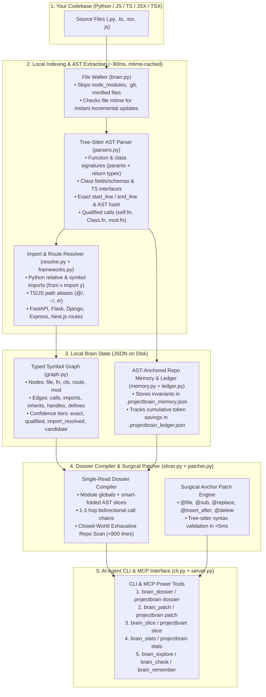

# ProjectBrain (`projectbrain-mcp`) — Setup & Architecture Guide

---

## 1. Installation & Setup (60 Seconds)

### Step 1: Install from PyPI
Install `projectbrain-mcp` once on your machine:

```bash
pip install projectbrain-mcp
```
* **What this installs:** Two global CLI commands: `projectbrain` (the CLI) and `projectbrain-mcp` (the MCP server for AI coding agents).
* **Zero bloat:** Uses pre-compiled C wheels (`tree-sitter` + `mcp`). No external database, no Docker, and no GPU/embeddings required.

---

### Step 2: Initialize Any Project in 1 Command
Run `init` on any repository where you want your AI agent to use ProjectBrain:

```bash
projectbrain --path /path/to/your/repo init
```
* **What `init` does automatically in ~0.5 seconds:**
  * Scans and indexes your codebase into `.projectbrain.json` and `.projectbrain_graph.json`.
  * Updates `.gitignore` so ephemeral index caches never pollute Git.
  * Creates `.mcp.json` in the repo root so MCP-compatible editors (Claude Code, Cursor, Windsurf, Antigravity) auto-detect the `projectbrain` server.
  * Creates `.agents/rules/projectbrain.md` instructing the AI agent to compile a single-read Engineering Dossier (`brain_dossier` / `projectbrain dossier`) first instead of running blind `grep` searches or reading entire files, and to apply edits with `brain_patch`.

---

### Step 3: Parent / Monorepo Workspace Setup (If Opening a Parent Folder)
If your IDE workspace is opened at a **parent folder** containing sub-repositories (e.g. `D:\workspace\my-app`), place an `AGENTS.md` (or `.agents/rules/projectbrain.md`) at the **parent workspace root** and pass `--path "<subfolder>"` in the rules so the agent automatically invokes ProjectBrain on the child repo:

```markdown
# ProjectBrain Mandatory Codebase Investigation & Editing Rules

Whenever investigating, answering questions about, or modifying `<subfolder>`, you **MUST ALWAYS use ProjectBrain FIRST** before running shell searches (`rg`, `Get-ChildItem`, `grep`) or multiple `read_file` calls:

1. **Compile a Single-Read Engineering Dossier (`projectbrain dossier`):**
   - Run `projectbrain --path "<subfolder>" dossier "<question_or_bug>"`
   - Immediately read `<subfolder>/.projectbrain_dossier.md` in **one single `read_file` call** (`StartLine=1, EndLine=800`).
2. **Surgical Symbol Slicing (`projectbrain slice`):**
   - Run `projectbrain --path "<subfolder>" slice --summary <file:symbol_or_start-end>` instead of reading full files.
3. **Surgical Anchor Patching (`projectbrain patch`):**
   - Run `projectbrain --path "<subfolder>" patch --spec "<Anchor Patch DSL>" --apply`
```

---

### Step 4: Keep Git Clean (`.gitignore`)
Add these entries to `.gitignore` to keep all local ProjectBrain files and agent rules untracked:

```gitignore
# ProjectBrain (local dev only)
.projectbrain*
*.projectbrain*
**/.projectbrain*
project_brain.py
test_projectbrain.json
.mcp.json
.agents/
AGENTS.md
CLAUDE.md
.claude/settings.json
```

---

### Step 5: Daily CLI & Live ROI Dashboard Commands

```bash
# 1. Compile a Single-Read Engineering Dossier (<800 lines in .projectbrain_dossier.md)
projectbrain --path /path/to/repo dossier "how does onboarding questionnaire assign persona"

# 2. Surgically slice specific symbols or line ranges
projectbrain --path /path/to/repo slice --summary src/App.tsx:ProtectedRoute

# 3. Apply a Surgical Anchor Patch (cuts output tokens by 65-80%)
projectbrain --path /path/to/repo patch --apply --spec "@file src/App.tsx
@sub L84 \`!profileCompleted\` -> \`isHydrated && !profileCompleted\`"

# 4. View the Live ROI & Token Savings Dashboard
projectbrain --path /path/to/repo stats --summary

# 5. Reset the savings ledger
projectbrain --path /path/to/repo stats --reset
```

---

## 2. Architecture Diagram


